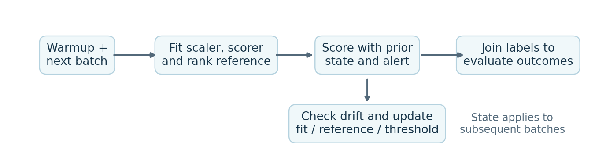
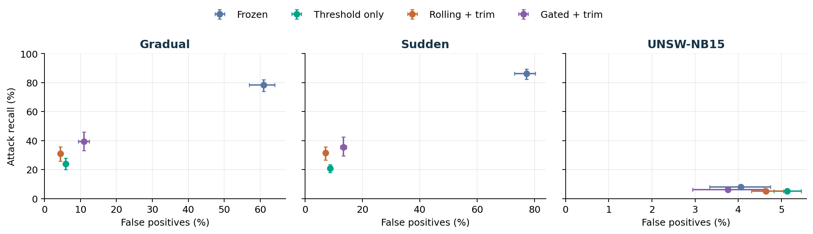
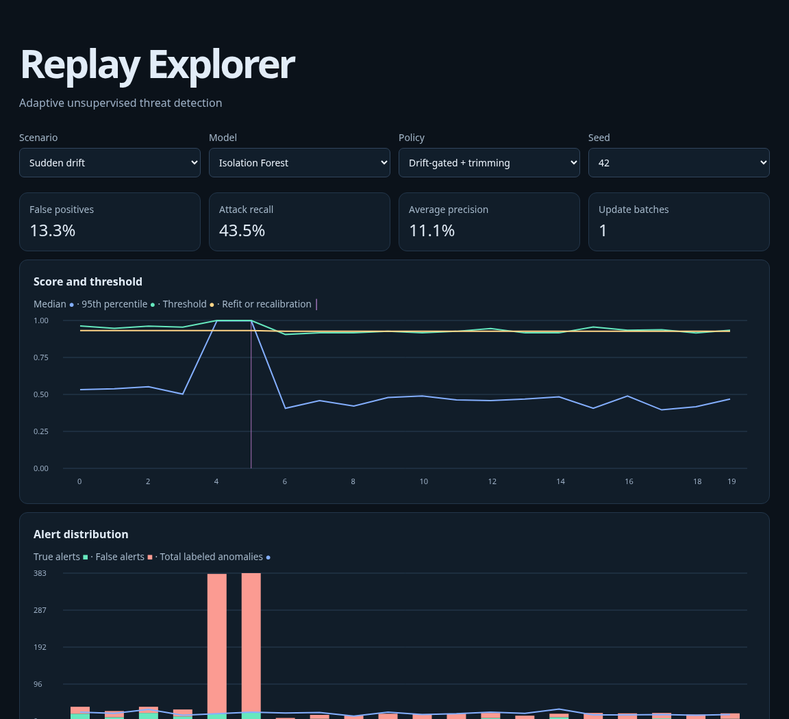

# Adaptive Unsupervised Threat Detection

A defensive research benchmark for streaming network telemetry. It tests whether adaptive detectors recover ranking and reduce false alerts when benign behavior shifts, and whether contaminated updates erase that benefit.



## Study design

- **Six anomaly models:** Isolation Forest, Local Outlier Factor, One-Class SVM, a NumPy autoencoder, a NumPy variational autoencoder, and a rank ensemble.
- **Seven policy variants:** frozen, threshold-only, rolling, rolling with trimming, drift-gated, drift-gated with trimming, and drift-gated fit-only.
- **Five replay scenarios:** stationary, gradual drift, sudden drift, a contamination burst, and UNSW-NB15 cyber-range flows. Compare deployed alert metrics and retrospective false positives at matched recall across ten seeds.
- **Replay controls:** score each batch before updating, keep labels outside the policy, and reserve distinct data for fit, rank reference, and alert calibration.

## Measured results

Across 1,100 model-policy replays, adaptation was sensitive to how often attacks entered updates. For Isolation Forest under sudden drift, gating and trimming reduced false positives at 60% recall by **35.6 percentage points** (95% paired bootstrap interval −42.8 to −28.2). At the deployed threshold recall fell by **50.6 points**. On UNSW-NB15, matched-recall FPR rose by **8.0 points** (95% interval +5.3 to +10.6). Gated updates occurred in batches averaging **70.8% attacks**, compared with 27.3% in other batches.

| Scenario | Policy | FPR | Recall | FPR at 60% recall |
|---|---|---:|---:|---:|
| Stationary | Frozen | 5.2% | 54.6% | 6.8% |
| Stationary | Gated + trim | 5.2% | 54.6% | 6.8% |
| Gradual drift | Frozen | 60.9% | 78.3% | 51.5% |
| Gradual drift | Gated + trim | 11.0% | 39.3% | 20.7% |
| Sudden drift | Frozen | 77.2% | 86.1% | 59.5% |
| Sudden drift | Gated + trim | 13.4% | 35.5% | 23.8% |
| Sudden drift + burst | Frozen | 76.4% | 89.9% | 55.4% |
| Sudden drift + burst | Gated + trim | 13.8% | 28.5% | 28.8% |
| UNSW-NB15 replay | Frozen | 4.1% | 8.0% | 49.7% |
| UNSW-NB15 replay | Gated + trim | 3.8% | 6.1% | 57.7% |



UNSW-NB15 release partitions lack timestamps. The public-data arm uses a documented replay order and a deduplicated holdout, so it does not establish chronological resilience on production traffic. Test FPR at 60% recall is a retrospective ranking metric. The deployed policy uses its own unlabeled calibration threshold.



## Run the benchmark

Use Python 3.11 or 3.12.

```sh
python -m venv .venv
source .venv/bin/activate
python -m pip install -r requirements.txt
python -m pip check
OPENBLAS_NUM_THREADS=1 python -m unittest discover -s tests -v
python scripts/download_unsw.py
OPENBLAS_NUM_THREADS=1 OMP_NUM_THREADS=1 python -m adaptive.benchmark \
  --unsw data/UNSW_NB15_training-set.csv data/UNSW_NB15_testing-set.csv
python -m adaptive.dashboard
python scripts/report.py
```

Generate the dashboard from checked-in results with `python -m adaptive.dashboard --source results/study.json.gz`. Open `results/replay.html` in a browser to inspect scores, thresholds, alerts, and drift by scenario, model, policy, and seed. The benchmark also runs when `--unsw` is omitted. The full research PDF expects the UNSW arm. The dashboard needs no server once generated.

[Research report](results/adaptive-threat-detection-report.pdf) · [Methodology and citations](docs/METHODOLOGY.md) · [Technical interview preparation](docs/INTERVIEW.md)

## Limits and next experiments

The benchmark assumes a clean warmup. Updates can absorb attacks that score below the trimming cutoff, and the rank and alert calibration subsets can still contain attacks. Extend the experiment to a timestamped external dataset and test drift-gate sensitivity and calibration with separately adjudicated benign flows.

Code and experimental execution were AI-assisted. The code license covers repository source and does not redistribute UNSW-NB15 data.
