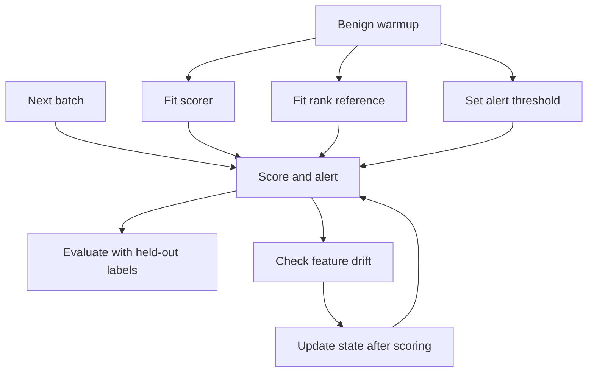

# Methodology

## Questions and hypotheses

1. Does adaptation recover discrimination after benign drift, or merely raise the alert threshold? Compare deployed false-positive rate and recall with the retrospective operating point at 60% recall.
2. Does limiting retraining to persistent changes reduce compute without sacrificing detection? Pair the rolling and gated policies at equal trimming settings.
3. Does score-based trimming reduce the share of malicious samples admitted to training during a contamination burst? Compare fitted-row selection and report the downstream detection trade-off.
4. Do neural reconstruction scores and a mixed-model ensemble improve ranking under the same replay, training budget, and label availability?

The study treats a false positive as a benign flow that crosses the current alert threshold. A drift flag describes a change in the feature distribution. It gives no causal information about whether the change originated in benign activity or an attack.

## Input construction

### Controlled streams

Each seed generates a correlated 12-dimensional benign process using three latent factors and independent noise. The unchanged stream uses the starting distribution throughout. Gradual drift interpolates a location and scale shift over seven batches. Sudden drift applies the full shift from batch 4. The burst arm increases the contamination probability from 5% to 25% in batches 8 through 11. The tests share random draws across scenarios within a seed. The third anomaly family appears only in the latter half of the sequence. All model warmups contain only benign data.

### UNSW-NB15

Use the author's [dataset page](https://research.unsw.edu.au/projects/unsw-nb15-dataset) for provenance, references, and terms. The study uses the published 175,341-row training and 82,332-row test partition files from a [public mirror](https://github.com/Jash-2000/Machine-Learning-Projects/tree/main/UNSW-Network_Packet_Classification). SHA-256 digests in the benchmark output identify the bytes actually used. These are experimental cyber-range flows that mix benign activity and generated attacks. The repository distributes no raw data.

Select the 16 flow-local numeric fields listed in the loader. Exclude IDs, labels, inferred protocol categories and history-based connection counts. Drop non-finite rows. Deduplicate benign training vectors, drop all multiplicities of duplicated test vectors regardless of label, and exclude any test vector equal to a benign training vector. This aggressive duplicate policy avoids overlap and can change attack prevalence. Uniformly sample benign warmup rows from the training partition. Split the test partition into equal source-order bins, sample without replacement in each bin, and preserve source order within that bin. The provided partitions lack capture timestamps. This replay measures policy sensitivity to the partition distribution and the scripted replay order. It cannot establish adaptation to real chronological drift.

## Fit, calibration and observation order

A robust scaler fits solely on the model fit subset. UNSW counts and rates first receive a fixed log1p transform. All scaled features are clipped at ±15. Each model's score is mapped to its left empirical rank on a separate held-back reference set with a monotone extension outside the observed score range. The ensemble averages ranks from Isolation Forest, novelty-mode Local Outlier Factor and a deterministic autoencoder. A third disjoint set sets the upper empirical quantile with a strict greater-than alert. Rank estimates can tie, and small calibration windows make the realized alert rate discrete.

At time t, score the entire batch with state from earlier batches. Alert, record the scores and then update. Evaluation joins the ground-truth labels after the replay call. For update batches, interleave 50% fit candidates, 25% rank reference, and 25% threshold calibration by row index modulo four. The fitting window has the same capacity as the warmup training set. The trim policy drops the highest-scoring 15% of the fitting candidates under the prior model. The threshold and rank subsets remain untrimmed so their high tails remain measurable. Those subsets can still be contaminated.

The drift statistic is the median across features of the absolute shift between the current batch median and the reference median divided by the reference interquartile range. Two consecutive readings of at least 0.32 trigger a gated update. A refit refreshes the reference and resets the streak. This fixed-window heuristic has no calibrated false alarm guarantee. Highly sparse changes can be hidden by the median across features.

| Policy | Refit | Recalibrate | Drift gate | Trim |
|---|---|---|---|---|
| Frozen | | | | |
| Threshold | | Yes | | |
| Rolling | Yes | Yes | | |
| Rolling + trim | Yes | Yes | | Yes |
| Gated | Yes | Yes | Yes | |
| Gated + trim | Yes | Yes | Yes | Yes |
| Gated fit only | Yes | | Yes | Yes |

## Neural scorers

The autoencoder uses a 24-unit tanh encoder and decoder with a linear latent and output. It minimizes mean squared reconstruction error with manual gradients, seeded Glorot initialization, and Adam. The VAE emits a latent mean and bounded log variance, samples with the reparameterization trick while fitting, and adds a 0.02-weighted mean Gaussian KL penalty. It scores mean-latent reconstructions deterministically. The tests compare analytic gradients against centered finite differences for every parameter array in both networks.

## Reporting

Pool rows by seed and policy for AUROC, average precision, FPR, recall, precision, and the descriptive FPR at ≥60% recall. Compute that point from the test scores for ranking comparison only. Its threshold is unavailable at deployment. Pooled scores can move as the rank reference changes. The dashboard also retains batch metrics for diagnosis. Score time measures local wall time for transformation and prediction, and update time includes refits and recalibration. Report latency in batches where ground truth supports it, including the first alert for the injected unknown family and whether a synthetic drift is signaled. The report uses percentile bootstrap intervals over 4,000 resamples of the ten seeds, with paired policy deltas relative to the frozen model. For UNSW the intervals summarize replay and seed sensitivity on one corpus.

## References

1. Liu, Ting, and Zhou. [Isolation-Based Anomaly Detection](https://doi.org/10.1145/2133360.2133363). ACM TKDD, 2012.
2. Breunig, Kriegel, Ng, and Sander. [LOF: Identifying Density-Based Local Outliers](https://doi.org/10.1145/342009.335388). ACM SIGMOD, 2000.
3. Schölkopf et al. [Estimating the Support of a High-Dimensional Distribution](https://doi.org/10.1162/089976601750264965). Neural Computation, 2001.
4. Hinton and Salakhutdinov. [Reducing the Dimensionality of Data with Neural Networks](https://doi.org/10.1126/science.1127647). Science, 2006.
5. Kingma and Welling. [Auto-Encoding Variational Bayes](https://arxiv.org/abs/1312.6114). ICLR, 2014.
6. Bifet and Gavaldà. [Learning from Time-Changing Data with Adaptive Windowing](https://doi.org/10.1137/1.9781611972771.42). SIAM SDM, 2007.
7. Moustafa and Slay. [UNSW-NB15: A comprehensive data set for network intrusion detection systems](https://doi.org/10.1109/MilCIS.2015.7348942). MilCIS, 2015.
8. Moustafa and Slay. [The evaluation of Network Anomaly Detection Systems](https://doi.org/10.1080/19393555.2015.1125974). Information Security Journal, 2016.
9. Moustafa et al. [Novel geometric area analysis technique for anomaly detection using trapezoidal area estimation on large-scale networks](https://ieeexplore.ieee.org/document/7948715). IEEE Transactions on Big Data, 2017.
10. Moustafa et al. [Big data analytics for intrusion detection system: statistical decision-making using finite Dirichlet mixture models](https://link.springer.com/chapter/10.1007/978-3-319-59439-2_5). Data Analytics and Decision Support for Cybersecurity, 2017.
11. Sarhan et al. [NetFlow Datasets for Machine Learning-Based Network Intrusion Detection Systems](https://arxiv.org/abs/2011.09144). BDTA, 2020.
